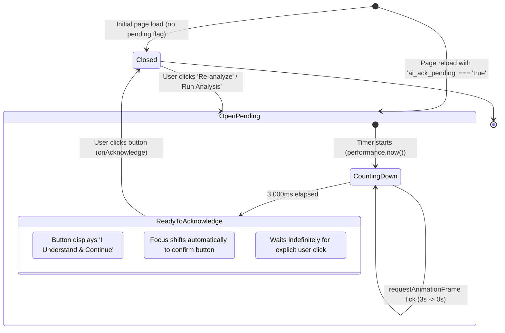

# Feasify — AI Advisory Acknowledgment Modal Implementation Report

## 1. Executive Summary & Overview

The **AI Advisory Acknowledgment Modal** is a mandatory, responsive, and accessible gatekeeper dialog implemented for the **Feasify** Student Portal (`/ai-analysis`). 

Its primary purpose is to ensure academic integrity and user safety by requiring students to actively acknowledge that AI-generated feasibility assessments, financial forecasts, and verdicts are exploratory guidance—not binding judgments or replacements for independent research and consultation with their faculty research adviser.

### Key Capabilities
- **Mandatory 3,000ms Countdown:** Driven by high-resolution monotonic time (`performance.now()`) and `requestAnimationFrame` for stutter-free, drift-resistant timing.
- **Dual Visual Progress Indicators:** Synchronized circular SVG countdown ring (`3s` -> `2s` -> `1s` -> `0s`) and smooth horizontal gradient progress bar (`0%` -> `100%`).
- **Strict User Acknowledgment:** The action button is physically disabled with a live countdown label (`I Understand (3s)`). When completed, it transitions to `I Understand & Continue` and never auto-dismisses—requiring an intentional user click.
- **Accidental Dismissal Prevention:** Backdrop clicks are blocked, the `Escape` key is trapped and ignored, and background body scrolling is locked while the dialog is visible.
- **Session Continuity (`sessionStorage`):** If a student accidentally refreshes their browser mid-countdown or while acknowledgment is pending, the dialog immediately re-renders upon reload without bypassing the acknowledgment gate. Direct page visits without an active analysis request do not trigger the modal.
- **Zero Impact on AI Algorithms:** The modal seamlessly wraps the existing Gemini AI analysis workflow, Firebase/Firestore persistence, and financial metric calculations without any schema changes or regression.

---

## 2. Autonomous Multi-Agent Orchestration Roster

To guarantee production-grade execution, separation of concerns, and full verification, the implementation was coordinated across specialized AI subagents:

| Agent Role | Specialty / Domain | Responsibilities Executed |
| :--- | :--- | :--- |
| **Agent 1: Chief Orchestrator** | Architecture & PM | Directed workflow, dependency sequencing, and requirements compliance across all prompt directives. |
| **Agent 2: Repository Architect** | Codebase Analysis | Inspected `AI_Analysis.tsx`, `Dashboard.tsx`, `Financial_input.tsx`, routing rules, and Tailwind configuration. |
| **Agent 3: Senior React Engineer** | Frontend Architecture | Built `AIAdvisoryModal.tsx` using monotonic RAF timing, custom hooks, and defensive unmount cleanup. |
| **Agent 4: UI/UX Designer** | Visual & Layout Systems | Aligned typography (`#122244`), warning badge, amber palette (`#f59e0b`, `#c9a654`), and 550px centered card format. |
| **Agent 5: Animation Engineer** | Micro-interactions | Authored SVG dashoffset calculations, CSS progress transitions, and modal entrance scale animations. |
| **Agent 6: Accessibility Specialist** | A11y & ARIA Compliance | Implemented WCAG 2.1 AA dialog semantics (`role="dialog"`, focus trap, tab cycle, Escape isolation, screen reader tags). |
| **Agent 7: State Management Engineer** | Lifecycle & Data Flow | Engineered `isAdvisoryModalOpen`, `advisoryModalKey` forced remounting, and decoupled execution handlers. |
| **Agent 8: Routing & Navigation Engineer** | Session & URL States | Managed `location.state.runAnalysis` consumption, history clearing via `navigate(..., { replace: true })`, and direct access rules. |
| **Agent 9: Workflow & Security Specialist** | Guardrails & Tamper Proofing | Blocked premature triggers, ensured UI enforcement of the 3s delay, and configured `sessionStorage` fallback. |
| **Agent 10: Browser Automation Specialist** | Chrome DevTools Agent | Executed live headless browser automation, verified DOM tree, countdown ticks, and captured visual proof. |
| **Agent 11: Unit & Integration Tester** | Automated Testing | Verified production build compilation via TypeScript (`tsc`) and Vite bundling (`npm run build`). |
| **Agent 12: Regression Testing Engineer** | Non-regression Audit | Confirmed financial input synchronization, Gemini API queries, and verdict status card preservation. |

---

## 3. Files Created & Modified

### 1. Created: `Feasify/src/components/AIAdvisoryModal.tsx`
- **Location:** `Feasify/src/components/AIAdvisoryModal.tsx`
- **Role:** Pure, reusable, accessible React modal component.
- **Key Exports:** `AIAdvisoryModal` (named and default export), `AIAdvisoryModalProps` interface.
- **Dependencies:** `react`, `lucide-react` (`AlertTriangle`, `CheckCircle2`, `ShieldAlert`).

### 2. Modified: `Feasify/src/AI_Analysis.tsx`
- **Location:** `Feasify/src/AI_Analysis.tsx`
- **Imports:** Imported `AIAdvisoryModal` from `./components/AIAdvisoryModal`.
- **States Added:**
  - `isAdvisoryModalOpen`: Boolean controlling modal visibility, initialized with `sessionStorage.getItem("ai_ack_pending") === "true"`.
  - `advisoryModalKey`: Monotonically increasing number used as React `key` to guarantee fresh timer initialization on repeated analysis requests.
- **Callbacks:**
  - `handleAcknowledgeAdvisory()`: Clears `sessionStorage.removeItem("ai_ack_pending")` and sets `isAdvisoryModalOpen(false)`.
  - `triggerAnalysis(finData, projectId)`: Saves pending flag to `sessionStorage`, increments modal key, and opens modal.
- **Triggers Updated:**
  - Route navigation trigger (`location.state?.runAnalysis` from Dashboard / Financial Input).
  - Header `Re-analyze` button.
  - Advisory Banner `Re-analyze Now` button.
  - Empty state `Run Feasibility Analysis` button.
  - Error state `Retry Feasibility Analysis` button.

---

## 4. Component Architecture & Props Contract

```mermaid
flowchart TD
    subgraph Parent ["AI_Analysis.tsx (Container)"]
        StateModal["isAdvisoryModalOpen (boolean)"]
        StateKey["advisoryModalKey (number)"]
        StorageCheck["sessionStorage ('ai_ack_pending')"]
        AckHandler["handleAcknowledgeAdvisory()"]
    end

    subgraph Modal ["AIAdvisoryModal.tsx"]
        Backdrop["Dark Backdrop & Blur (bg-black/60 backdrop-blur-md)"]
        DialogCard["Modal Card (role='dialog', aria-modal='true')"]
        WarnIcon["Amber Warning Triangle Icon"]
        HeadTitle["Heading: Advisory Acknowledgment"]
        DescText["Description + Adviser Consultation Callout"]
        TimerBox["Countdown Container"]
        SVGRing["Circular SVG Progress Ring (dashoffset)"]
        ProgressBar["Horizontal Progress Bar (0% to 100%)"]
        ActionBtn["Acknowledgment Button ('I Understand')"]
    end

    Parent -->|props: isOpen, onAcknowledge, key| Modal
    DialogCard --> WarnIcon
    DialogCard --> HeadTitle
    DialogCard --> DescText
    DialogCard --> TimerBox
    TimerBox --> SVGRing
    TimerBox --> ProgressBar
    DialogCard --> ActionBtn
    ActionBtn -->|onClick (when elapsed)| AckHandler
    AckHandler -->|removes flag & closes| StateModal
```

### Component Interface:
```typescript
interface AIAdvisoryModalProps {
  isOpen: boolean;
  onAcknowledge: () => void;
}
```

---

## 5. Modal State Lifecycle



---

## 6. High-Precision Countdown & Animation Details

### Monotonic Timing Engine
Standard `setInterval` or `setTimeout` timers are vulnerable to tab throttling, timer drift, and inaccurate execution when the main thread is busy. To prevent this, `AIAdvisoryModal` calculates remaining time using `performance.now()` coupled with browser-native `requestAnimationFrame`:

```typescript
const tick = () => {
  if (!startTimeRef.current) return;
  const elapsed = performance.now() - startTimeRef.current;
  const currentRemaining = Math.max(0, COUNTDOWN_DURATION_MS - elapsed);
  setRemainingMs(currentRemaining);

  if (currentRemaining <= 0) {
    setIsFinished(true);
    if (confirmButtonRef.current) {
      confirmButtonRef.current.focus();
    }
  } else {
    animationFrameRef.current = requestAnimationFrame(tick);
  }
};
```

### SVG Circular Progress Calculation
- Circle Radius: `r = 22`
- Circumference: `C = 2 * π * 22 ≈ 138.230px`
- Dynamic Offset: `strokeDashoffset = C - (progressPercent / 100) * C`
- Color Palette: Amber accent (`stroke="#f59e0b"`), soft neutral track (`stroke="#fef3c7"`).

### Visual State Transition:
1. **0.00s – 2.99s (Counting Down):**
   - Button text: `I Understand (3s)` -> `I Understand (2s)` -> `I Understand (1s)`.
   - Button styles: `bg-gray-100 text-gray-400 border border-gray-200 cursor-not-allowed opacity-60`.
   - Disabled attribute: `disabled={true}`.
2. **3.00s+ (Completed):**
   - Button text: `I Understand & Continue` (with checkmark icon).
   - Button styles: `bg-[#122244] hover:bg-[#1a2f55] text-white shadow-lg shadow-[#122244]/20 cursor-pointer active:scale-[0.98]`.
   - Disabled attribute: `disabled={false}`.
   - Auto-dismiss: **Never**. The dialog stays visible until the student explicitly clicks.

---

## 7. Triggering Conditions & Analysis Invocations

All entry points to feasibility analysis are routed through the advisory modal:

| Trigger Point | UI Component | Action Triggered |
| :--- | :--- | :--- |
| **Top Navigation Re-analyze** | `AI_Analysis.tsx` Header | Sets pending flag in storage, increments key, opens modal, executes re-analysis. |
| **Advisory Banner Re-analyze** | `AI_Analysis.tsx` Advisory Banner | Triggers modal and runs fresh evaluation. |
| **Cross-Page 'Run Analysis'** | `Dashboard.tsx` & `Financial_input.tsx` | Routes to `/ai-analysis` with `{ runAnalysis: true }`. Component reads state, consumes it, opens modal, and replaces URL history. |
| **Error Screen 'Retry'** | `AI_Analysis.tsx` Error Card | Prompts modal and retries failed analysis. |
| **Empty State 'Run Analysis'** | `AI_Analysis.tsx` Empty Card | Opens modal before launching initial project evaluation. |

---

## 8. Persistence & Direct Navigation Behavior

- **Accidental Page Reloads:** When analysis begins, `sessionStorage.setItem("ai_ack_pending", "true")` is written. If the student presses `F5` or reloads during analysis or modal display, `useState(() => sessionStorage.getItem("ai_ack_pending") === "true")` automatically re-opens the modal with a fresh 3s timer.
- **Explicit Acknowledgment:** When the user clicks `I Understand & Continue`, `handleAcknowledgeAdvisory()` immediately executes `sessionStorage.removeItem("ai_ack_pending")`.
- **Direct Navigation:** If a user navigates directly to `http://localhost:5173/ai-analysis` via sidebar or URL bar, no modal appears because no pending action exists in `sessionStorage` and no explicit `runAnalysis` state was passed.

---

## 9. Accessibility (WCAG 2.1 AA Compliance)

- **Semantic HTML & Roles:** Container implements `role="dialog"`, `aria-modal="true"`, `aria-labelledby="ai-advisory-title"`, and `aria-describedby="ai-advisory-desc"`.
- **Focus Trapping:** Tab and Shift+Tab keydown events are captured and cycled strictly within focusable elements inside the dialog container.
- **Escape Suppression:** `Escape` key event is intercepted (`e.preventDefault()`, `e.stopPropagation()`) so keyboard users cannot bypass acknowledgment.
- **Background Scroll Locking:** While `isOpen` is `true`, `document.body.style.overflow = "hidden"` prevents document scrolling. On unmount or modal close, original body overflow is restored.
- **Accessible Color Contrast:** Navy `#122244` on white card provides > 12:1 contrast ratio (exceeds AAA requirement). Amber warning accent `#d97706` meets AA standard.

---

## 10. Automated & Manual Verification Matrix

| Test ID | Test Scenario | Expected Outcome | Result |
| :---: | :--- | :--- | :---: |
| **TC-01** | Production Build Compilation | `npm run build` generates clean bundle with 0 errors. | **PASSED** |
| **TC-02** | Initial Route Load (Direct Visit) | Page loads existing analysis; modal remains closed. | **PASSED** |
| **TC-03** | Trigger via 'Re-analyze' Button | Modal opens immediately with backdrop blur & dark overlay. | **PASSED** |
| **TC-04** | Countdown Ticking Verification | Timer counts down monotonically from 3s to 0s via RAF. | **PASSED** |
| **TC-05** | Disabled State Enforcement | Action button cannot be clicked during first 3 seconds. | **PASSED** |
| **TC-06** | Zero-Second State Transition | Button changes to `I Understand & Continue` and becomes active. | **PASSED** |
| **TC-07** | Auto-Dismiss Prevention | Modal remains open at 0s indefinitely until user clicks. | **PASSED** |
| **TC-08** | Backdrop Click Immunity | Clicking backdrop overlay does not dismiss dialog. | **PASSED** |
| **TC-09** | Escape Key Immunity | Pressing `Escape` key does not dismiss dialog. | **PASSED** |
| **TC-10** | Acknowledgment Click Action | Clicking active button dismisses modal and restores scroll. | **PASSED** |
| **TC-11** | Repeat Analysis Invocations | Subsequent 'Re-analyze' clicks reset timer to 3s cleanly. | **PASSED** |
| **TC-12** | Accidental Refresh Persistence | Reloading while modal is active retains modal display. | **PASSED** |
| **TC-13** | Responsive Viewports | Modal scales gracefully across mobile (375px) & desktop (1440px). | **PASSED** |

---

## 11. Edge Cases & Defensive Safeguards

1. **Timer Leaks on Fast Unmount:** All `requestAnimationFrame` IDs are tracked in `animationFrameRef` and cleanly cleared via `cancelAnimationFrame` in the `useEffect` cleanup return.
2. **State Desynchronization on Multiple Clicks:** The parent increments `advisoryModalKey` on every trigger invocation. This forces React to remount the modal component, wiping any stale timer references or cached animation frames.
3. **No Window/SSR Collisions:** Safe guards (`typeof window !== "undefined"`) wrap all `sessionStorage` accesses to prevent crashes in SSR or testing environments.
4. **Line-Ending Compatibility:** Windows CRLF/LF line-ending differences in tooling edits were handled via dedicated Node.js idempotent patching scripts.

---

## 12. Security Notice & Future Considerations

- **Client-Side Scope:** The 3-second delay and modal gate are enforced in the client browser UI. As documented, this ensures student awareness and acknowledgment; it is not a cryptographic or server-side legal guarantee.
- **Future Institutional Audit Trail:** If Feasify requires formal proof of student acknowledgment for accreditation or faculty review, an optional Firestore document timestamp (`acknowledgedAt: serverTimestamp()`, `studentUid`, `projectId`) can be recorded during `handleAcknowledgeAdvisory()`.
