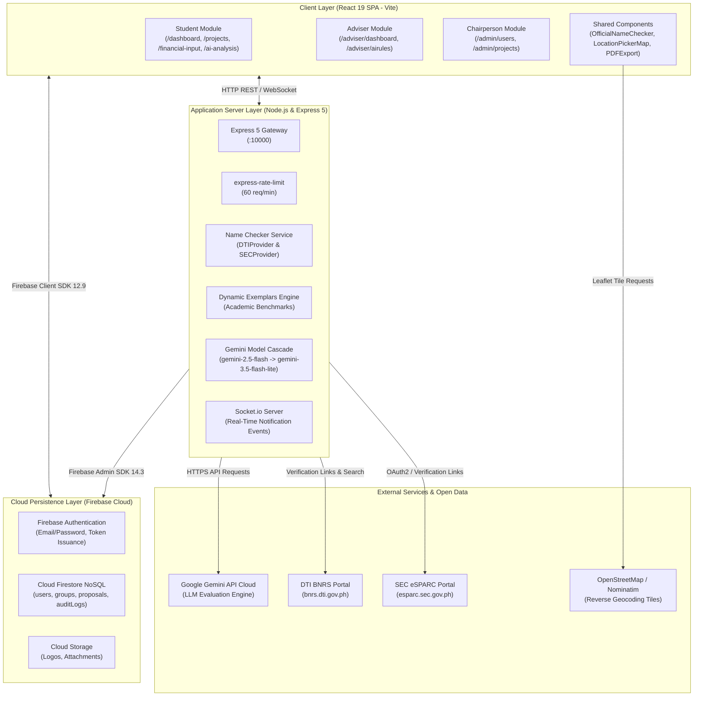
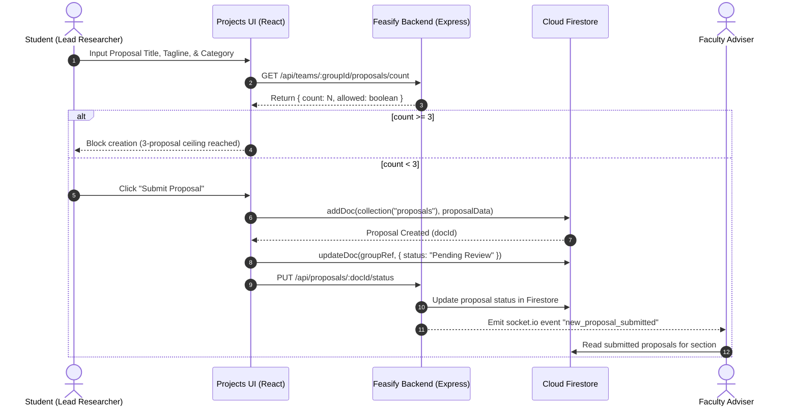

# FEASIFY SYSTEM ANALYSIS AND ARCHITECTURE SPECIFICATION
**Document ID:** FEASIFY-DOC-001  
**Version:** 1.0.0  
**Date:** November 10, 2026  
**Author:** Lead QA Orchestrator & Project Discovery Agent  
**Classification:** Academic Capstone Technical Documentation  

---

## 1. Executive Summary

Feasify is a web-based capstone proposal and feasibility management system designed to support undergraduate and graduate students, faculty advisers, and academic department chairpersons in managing feasibility studies. The system facilitates end-to-end workflows including student group formation, capstone proposal authoring, financial projection computation, artificial intelligence (AI)-assisted feasibility evaluations, official business name verification, and administrative audit logging.

This document presents a comprehensive technical discovery and architectural analysis derived from an empirical inspection of the Feasify repository.

---

## 2. Technology Stack Identification

The empirical audit of `package.json`, configuration files, and source trees identifies the actual technology stack:

| Layer | Component / Tool | Version | Purpose |
|---|---|---|---|
| **Frontend Framework** | React | `^19.2.0` | Declarative component UI library |
| **Frontend Build Tool** | Vite | `^7.3.1` | Ultra-fast ESM development and production bundler |
| **Language (Frontend)** | TypeScript | `~5.9.3` | Type-safe static analysis for React components |
| **Styling & Design** | Tailwind CSS | `^4.2.0` | Utility-first responsive CSS framework |
| **Routing** | React Router DOM | `^7.13.0` | Client-side routing and protected route guards |
| **State & Backend as a Service** | Firebase Client SDK | `^12.9.0` | Firebase Auth and Cloud Firestore client communication |
| **Icons & UI Primitives** | Lucide React | `^0.575.0` | Consistent iconography across dashboards |
| **Mapping & Geolocation** | Leaflet | `^1.9.4` | Open-source interactive map engine (OpenStreetMap) |
| **Document Export** | jsPDF & jsPDF-AutoTable | `^4.2.1` / `^5.0.9` | Client-side PDF generation of feasibility dossiers |
| **Spreadsheet Processing** | SheetJS (xlsx) | `^0.20.1` | Excel file import and export for student rosters |
| **Backend Runtime** | Node.js | `v22.20.0` (Active) | Server-side JavaScript runtime |
| **Backend Framework** | Express.js | `^5.2.1` | HTTP web application and REST API server |
| **Backend Language** | JavaScript (CommonJS) | ES2022 | Server-side API logic and service adapters |
| **Backend Admin SDK** | Firebase Admin | `^14.3.0` | Server-side privileged Firestore & Auth operations |
| **Real-Time Communication** | Socket.io / Socket.io-client | `^4.8.3` | WebSocket bi-directional event notifications |
| **AI Integration** | Google Generative AI SDK | `^0.21.0` / `^0.24.1` | Gemini model cascade for financial & proposal analysis |
| **Security & Rate Limiting** | express-rate-limit | `^8.6.2` | In-memory IP/Auth token API rate limiting |
| **Email Service** | EmailJS Browser SDK | `^4.4.1` | Client-triggered automated email dispatch |

---

## 3. System Architecture

Feasify utilizes a hybrid client-heavy Single Page Application (SPA) architecture combined with a Node.js/Express companion backend and Firebase cloud services (Auth, Firestore, Cloud Storage).

### 3.1 Architecture Diagram

### 3.2 Data Flow Architecture

---

## 4. Key Architectural Findings and Discoveries

### 4.1 Geolocation and Mapping Architecture
The codebase was scrutinized for Google Maps API integration.
* **Finding:** The project does **NOT** use Google Maps API.
* **Actual Implementation:** Feasify implements geolocation through **Leaflet `^1.9.4`** with OpenStreetMap raster tiles, supplemented by an embedded Philippine place search service (`src/services/philippinePlaceSearch.ts`) and offline landmark catalog (`src/data/philippineLandmarks.ts`).
* **Evaluation:** This approach avoids commercial Google Cloud API billing, preventing quota depletion during student usage while providing location picking and clean human-readable address formatting.

### 4.2 Official Name Checker Architecture
* **DTI BNRS:** Implemented via `feasify-backend/services/nameChecker/dti/DTIProvider.js`. It queries official enterprise API endpoints when credentials are provided. When unconfigured (public tier), it redirects users to the official search link `https://bnrs.dti.gov.ph/search?keyword=...` and clearly returns `NOT_FOUND` without falsely claiming that a name is "officially registered" or "legally available".
* **SEC Philippines:** Implemented via `feasify-backend/services/nameChecker/sec/SECProvider.js`. It explicitly distinguishes corporate entity lookup from definitive name reservation (conducted exclusively via SEC eSPARC).
* **Consolidation:** Company name data is centralized in `feasify-backend/data/companyNames.json` (1,234 records), preventing frontend code bloat.

### 4.3 Proposal Limit Architecture (Maximum 3 Proposals)
* **Client Enforcement:** `Projects.tsx` enforces `proposals.length >= 3` in client-side state and disables the "Submit" and "Save Draft" actions.
* **Backend Endpoint:** `feasify-backend/index.js` provides `GET /api/teams/:groupId/proposals/count` and `POST /api/teams/:groupId/proposals` with strict server-side `count >= 3` checks.
* **Critical Finding:** While the backend endpoint exists, `Projects.tsx` writes directly to Cloud Firestore using `addDoc(collection(db, "proposals"))` after querying the count endpoint, creating a potential Time-of-Check to Time-of-Use (TOCTOU) race condition and bypassing backend enforcement if an adversary interacts directly with the Firebase client library.

---

## 5. Comprehensive Feature Inventory

| Module Name | Purpose | Relevant Files | Associated DB Collections | Related Endpoints | Authorized Roles | Implementation Status |
|---|---|---|---|---|---|---|
| **Authentication & Profile** | User login, password recovery, session verification | `src/Auth.tsx`, `src/ResetPassword.tsx`, `src/firebase.ts` | `users` | Firebase Auth | Public / All | **Implemented** |
| **Role-Based Routing** | Restricts URL routes by user role | `src/components/ProtectedRoute.tsx`, `src/App.tsx` | `users` | N/A | Student, Adviser, Chairperson | **Implemented** |
| **Student Dashboard** | High-level metrics, active business summary | `src/Dashboard.tsx` | `groups`, `proposals` | N/A | Student | **Implemented** |
| **Proposal Management** | Create, edit, draft, and submit capstone proposals (Max 3) | `src/Projects.tsx` | `groups`, `proposals` | `GET/POST /api/teams/:groupId/proposals` | Student (Leader) | **Implemented** |
| **Financial Computation** | 5-year multi-product costing, OPEX, balance sheet | `src/Financial_input.tsx`, `src/utils/productCosting.ts` | `groups`, `proposals` | N/A | Student | **Implemented** |
| **AI Feasibility Analysis** | Evaluates financial feasibility via Gemini cascade | `src/AI_Analysis.tsx`, `feasify-backend/index.js` | `groups`, `proposals` | `POST /api/analyze` | Student | **Implemented** |
| **Official Name Checker** | Verifies business/company names vs DTI/SEC | `src/components/OfficialNameChecker.tsx`, `services/nameChecker/` | In-memory cache, `companyNames.json` | `POST /api/name-check` | Student, All | **Implemented** |
| **Interactive Map** | Location picker with reverse geocoding | `src/components/LocationPickerMap.tsx` | Embedded in `proposals` | OpenStreetMap Nominatim | Student | **Implemented (Leaflet)** |
| **Adviser Review Dashboard** | Review submitted proposals, issue remarks, approve/reject | `src/AdviserDashboard.tsx` | `groups`, `proposals`, `auditLogs` | `PUT /api/proposals/:proposalId/status` | Adviser, Chairperson | **Implemented** |
| **Adviser AI Proposal Evaluation** | Evaluates student proposals against rubrics | `src/AdviserDashboard.tsx`, `feasify-backend/index.js` | `knowledge_base.json` | `POST /api/analyze-proposal` | Adviser | **Implemented** |
| **Chairperson User Management** | Add students/advisers, batch import Excel | `src/ChairpersonModule.tsx` | `users` | Firebase Auth | Chairperson | **Implemented (Security Flaw Identified)** |
| **Chairperson Feasibility Overview** | Institutional overview of sections and feasibility proposals | `src/ChairpersonFeasib.tsx` | `groups`, `proposals` | N/A | Chairperson | **Implemented** |
| **Audit Trail & Logging** | Compliance logging of user actions | `src/services/auditLogger.ts`, `feasify-backend/index.js` | `auditLogs` | `GET /api/audit/logs` | Adviser, Chairperson | **Implemented** |
| **Dossier PDF Export** | Export formatted PDF feasibility study document | `src/utils/exportProposalAnalysisPDF.ts`, `src/Reports.tsx` | `proposals` | N/A (Client jsPDF) | Student, Adviser | **Implemented** |
