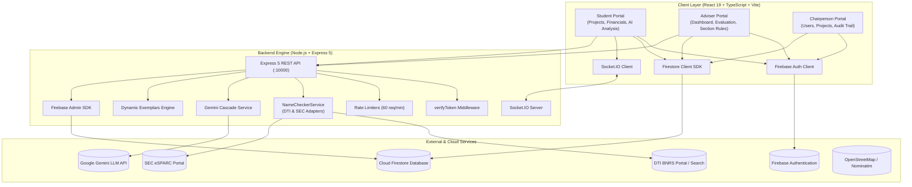
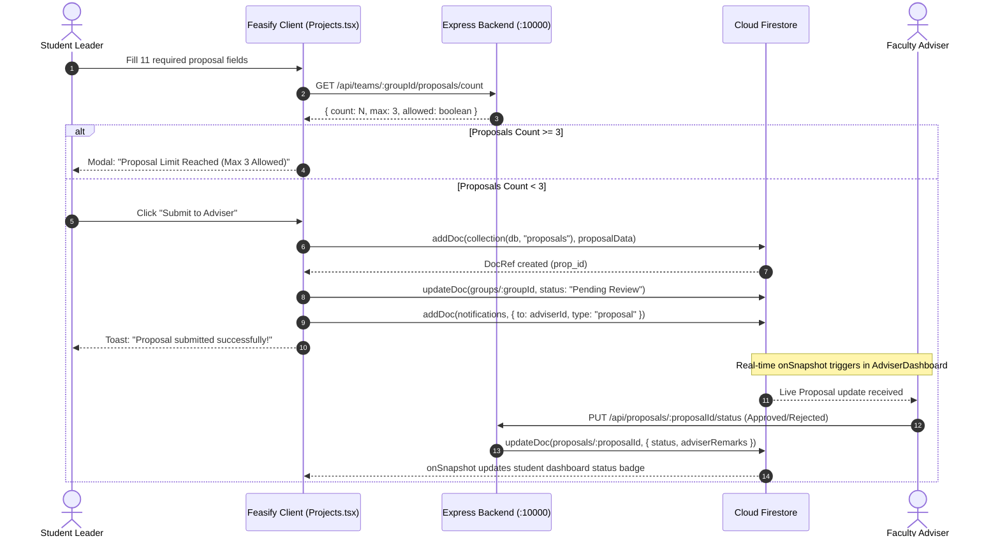

# 01. Feasify System Analysis and Architectural Specification

**Project Name:** Feasify Capstone System  
**Document ID:** FEASIFY-DOC-01  
**Audit Date:** November 11, 2026  
**Auditor:** QA Engineering & Architecture Review Team  
**Evaluation Target:** Production Codebase (`Feasify/` & `feasify-backend/`)  

---

## 1. Executive Summary

Feasify is an academic web-based capstone proposal and feasibility evaluation management system tailored for Philippine universities. The platform establishes collaborative workflows between three core user roles: **Students**, **Faculty Advisers**, and **Academic Chairpersons**. Feasify guides students through business proposal ideation, Philippine government registration name checks (DTI BNRS & SEC eSPARC), location mapping, 5-year financial statement projections (incorporating BMBE Act 3% smart tax vs. CREATE Act 20% CIT), and automated AI feasibility scoring powered by Google Gemini.

---

## 2. Actual Technology Stack Identification

Based on exhaustive static inspection of `Feasify/package.json` and `feasify-backend/package.json`, the verified technology stack is:

| Layer | Component / Library | Version | Verified Purpose |
|---|---|---|---|
| **Frontend Framework** | React | `^19.2.0` | Declarative reactive UI components |
| **Frontend Language** | TypeScript | `~5.9.3` | Type-safe client-side application logic |
| **Build & Dev Tool** | Vite | `^7.3.1` | Ultra-fast ESM frontend bundling and HMR |
| **Styling & Design** | Tailwind CSS & PostCSS | `^4.2.0` | Utility-first responsive design tokens |
| **Routing** | React Router DOM | `^7.13.0` | Client-side routing with role-based `ProtectedRoute` |
| **Database & Auth (Client)** | Firebase JS SDK | `^12.9.0` | Firebase Auth, Cloud Firestore client, Storage |
| **Real-Time Messaging** | Socket.IO Client | `^4.8.3` | Low-latency collaborative team messaging |
| **Mapping Engine** | Leaflet | `^1.9.4` | OpenStreetMap client with custom Philippine landmarks |
| **Charts & Data Viz** | Recharts | `^3.8.1` | Financial break-even, sensitivity, and radar charts |
| **Export Engines** | jsPDF, html2canvas, SheetJS (`xlsx`) | Latest | PDF generation, table rasterization, Excel exports |
| **Backend Runtime** | Node.js (CommonJS) | `>=18.0.0` | Backend asynchronous event-driven server runtime |
| **Backend Framework** | Express | `^5.2.1` | REST API routing and middleware management |
| **Backend Database/Auth** | Firebase Admin SDK | `^14.3.0` | Privileged Firestore access & ID token verification |
| **AI LLM Engine** | `@google/generative-ai` | `^0.21.0` | Multi-model cascade (`gemini-3.5-flash-lite`) |
| **Traffic Control** | `express-rate-limit` | `^8.6.2` | IP & token-based rate limiting (60 req/min) |

---

## 3. High-Level Architecture Diagrams

### 3.1 C4 Container Diagram

### 3.2 End-to-End Proposal Data Flow (DFD Level 1)

---

## 4. Feature Inventory & Implementation Matrix

| Module | Purpose | Key Files | DB Collection | API Endpoint | Roles | Implementation Status |
|---|---|---|---|---|---|---|
| **Authentication** | Registration, login, password reset, session persistence | `Auth.tsx`, `ResetPassword.tsx`, `firebase.ts` | `users` | Client SDK (`fbAuth`) | All | **Implemented** |
| **Role Routing** | RBAC route authorization and redirect | `ProtectedRoute.tsx`, `App.tsx` | `users` | Client Firestore lookup | All | **Implemented** |
| **Proposal Creation** | Business idea draft and submission | `Projects.tsx`, `proposalDetails.ts` | `proposals`, `groups` | Direct Firestore + `/api/teams/:id/proposals` | Student | **Implemented** |
| **3-Proposal Limit** | Enforce max 3 proposals per capstone team | `Projects.tsx`, `feasify-backend/index.js` | `proposals` | `/api/teams/:groupId/proposals/count` | Student | **Implemented** |
| **Name Checker** | DTI BNRS & SEC eSPARC name conflict check | `OfficialNameChecker.tsx`, `services/nameChecker/` | `companyNames.json`, `copyright_db.json` | `POST /api/name-check` | Student, Adviser | **Implemented** |
| **Location Mapping** | Philippine location selection and pin drop | `LocationPickerMap.tsx`, `philippinePlaceSearch.ts` | Stored in `proposals.proposedLocation` | Nominatim / Local DB | Student | **Implemented (Leaflet/OSM)** |
| **Financial Analysis** | 5-year statements, BMBE vs CREATE tax | `Financial_input.tsx`, `balanceSheetProjections.ts` | `proposals`, `financials` | `POST /api/analyze` | Student | **Implemented** |
| **AI Feasibility** | Automated Gemini feasibility audit & rubric | `AI_Analysis.tsx`, `AdviserAIRules.tsx` | `proposals` | `POST /api/analyze-financials`, `/api/analyze-proposal` | Student, Adviser | **Implemented** |
| **Adviser Review** | Review proposals, assign statuses, give remarks | `AdviserDashboard.tsx` | `proposals`, `groups` | `PUT /api/proposals/:id/status` | Adviser | **Implemented** |
| **Chairperson Oversight** | Cross-section project monitoring, user manager | `ChairpersonModule.tsx`, `ChairpersonFeasib.tsx` | `users`, `groups`, `proposals` | Client Firestore listeners | Chairperson | **Implemented** |
| **Audit Trails** | Immutable activity logging for compliance | `auditLogger.ts`, `AdviserAuditTrail.tsx` | `audit_logs` | `GET /api/audit/logs` | All | **Implemented** |
| **Collaboration Chat** | Team and adviser real-time messaging | `Messages.tsx`, `feasify-backend/index.js` | `messages` | Socket.IO (`io.on`) | All | **Implemented** |

---

## 5. Architectural Constraints & Key Observations

1. **Dual Database Access Paths:** Feasify uses direct client-side Firestore SDK writes (`addDoc`, `updateDoc`) alongside Express 5 backend endpoints.
2. **Mapping Engine Reality:** Google Maps is not utilized; the platform uses **Leaflet v1.9.4 with OpenStreetMap Nominatim** and local landmark fallbacks (`philippineLandmarks.ts`).
3. **Hardcoded Role Bypass:** `chairperson@gmail.com` bypasses database role verification in both `ProtectedRoute.tsx` (line 31) and `feasify-backend/index.js` (line 97).
4. **Government APIs:** Public DTI BNRS and SEC eSPARC do not offer open unauthenticated APIs. Feasify accurately implements standardized sandbox mocking, trademark protection under RA 8293, and official portal deep-linking.
