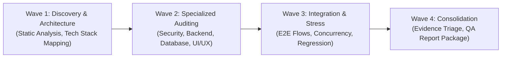

# FEASIFY SOFTWARE TEST PLAN (IEEE 829 FORMAT)
**Document ID:** FEASIFY-DOC-002  
**Version:** 1.0.0  
**Date:** November 10, 2026  
**Author:** Lead QA Orchestrator  
**Classification:** Quality Assurance & Testing Governance  

---

## 1. Introduction and Objectives

This Software Test Plan establishes the formal testing methodology, coverage targets, environmental parameters, and quality gates for the **Feasify Capstone Project**.

The primary objective is to subject Feasify to rigorous empirical quality assurance across frontend functionality, companion backend APIs, database persistence, role-based authorization, security configurations, and concurrent workload performance.

---

## 2. Multi-Agent Team Structure and Roles

Testing operations are orchestrated by the Lead QA Orchestrator directing 12 specialized sub-agents:

```mermaid
graph TD
    LEAD["Lead QA Orchestrator\n(Coordination, Defect Triage, Consolidated Sign-off)"]
    
    A01["Agent 01: Project Discovery & Architecture Auditor"]
    A02["Agent 02: Frontend Functional Tester"]
    A03["Agent 03: Backend & API Tester"]
    A04["Agent 04: Database & Data Integrity Auditor"]
    A05["Agent 05: Authentication & Security Specialist"]
    A06["Agent 06: Proposal Management Specialist"]
    A07["Agent 07: DTI/SEC Business Name Checker Specialist"]
    A08["Agent 08: UI/UX & Accessibility Specialist"]
    A09["Agent 09: Performance & Stress Testing Engineer"]
    A10["Agent 10: End-to-End Integration Tester"]
    A11["Agent 11: Automation & Regression Test Engineer"]
    A12["Agent 12: Technical Documentation Specialist"]

    LEAD --> A01
    LEAD --> A02
    LEAD --> A03
    LEAD --> A04
    LEAD --> A05
    LEAD --> A06
    LEAD --> A07
    LEAD --> A08
    LEAD --> A09
    LEAD --> A10
    LEAD --> A11
    LEAD --> A12
```

### 2.1 Agent Responsibility Matrix

| Agent ID | Specialized Area | Scope of Investigation | Primary Deliverable |
|---|---|---|---|
| **Agent 01** | Architecture & Discovery | Source code analysis, dependencies, tech stack discovery | System Analysis Report (`01_System_Analysis.md`) |
| **Agent 02** | Frontend Functional | UI interactions, routing, client state transitions, forms | Frontend Functional Cases (`03_Functional_Test_Cases.md`) |
| **Agent 03** | Backend & API | Express endpoints, HTTP methods, input validation, schemas | API Test Report (`07_API_Test_Report.md`) |
| **Agent 04** | Database & Integrity | Firestore schemas, transactions, orphaned data, indexes | Database Test Report (`05_Database_Test_Report.md`) |
| **Agent 05** | Security & Access Control | OWASP Top 10, Auth tokens, CORS, secrets, RBAC rules | Security Assessment (`08_Security_Assessment.md`) |
| **Agent 06** | Proposal Management | 3-proposal limit, draft saving, submission lifecycle | Proposal Verification Section (`03_Functional_Test_Cases.md`) |
| **Agent 07** | DTI/SEC Name Checker | BNRS/eSPARC verification, sanitization, trademark logic | Integration Verification (`04_Integration_Test_Report.md`) |
| **Agent 08** | UI/UX & Usability | Responsive viewports, WCAG accessibility, visual contrast | UI/UX Audit (`06_UI_UX_Test_Report.md`) |
| **Agent 09** | Performance & Stress | Concurrency benchmarks (1 to 50 users), latency profiling | Performance & Stress Report (`09_Performance_Stress_Test.md`) |
| **Agent 10** | End-to-End Integration | Cross-role workflows (Student -> Adviser -> Chairperson) | Integration Test Report (`04_Integration_Test_Report.md`) |
| **Agent 11** | Automation & Regression | Unit test suites, automated runners, assertion checks | Test Execution Summary (`11_Test_Execution_Summary.md`) |
| **Agent 12** | Documentation | Registry compilation, matrix formatting, final QA report | Consolidated Package (`12_Final_QA_Report.md`) |

---

## 3. Scope of Testing

### 3.1 In-Scope Modules
1. **User Authentication & Authorization:** Student, Adviser, and Chairperson login, logout, password reset, and RBAC routes.
2. **Proposal Lifecycle:** Authoring, draft saving, form validation, submit button mechanics, and strict 3-proposal limit enforcement.
3. **Financial Input Engine:** 5-year multi-product costing, contribution margin, break-even calculations, and statement of financial position.
4. **AI Feasibility Analysis:** Gemini model cascade failover, timeout handling, evaluation framework scoring.
5. **Government Name Checker:** DTI BNRS and SEC Philippines adapters, brand collision detection, rate-limiting, and link dispatching.
6. **Geolocation & Mapping:** Leaflet OpenStreetMap rendering, Philippine place suggestions, reverse geocoding.
7. **Adviser Workflow:** Proposal status evaluation, feedback history, PDF report export.
8. **Chairperson Administration:** User management, batch Excel import, institutional feasibility monitoring.

### 3.2 Out-of-Scope Modules
1. Live destructive modification of production cloud databases.
2. Live payment gateway integration (Feasify does not process financial credit card transactions).
3. Automated scraping of live government portals with CAPTCHA mechanisms (disallowed by legal/ethical guidelines).

---

## 4. Testing Environments

| Component | Test Environment Specification |
|---|---|
| **Operating System** | Windows 11 Enterprise (x64) |
| **Node.js Runtime** | Node.js `v22.20.0` |
| **Package Manager** | npm `10.9.2` |
| **Frontend Server** | Vite `7.3.2` development & production build (`dist/`) |
| **Backend Server** | Express `5.2.1` running on Node.js (`localhost:10000` / ephemeral test ports) |
| **Test Database** | Cloud Firestore / Local In-Memory Mock Store |
| **External AI Sandbox** | Google Gemini API (Mock / Test Cascade) |
| **Browser Engines** | Chromium / WebKit / Gecko headless simulators |

---

## 5. Testing Methodology and Execution Waves

1. **Wave 1: Discovery & Architecture:** Inspect complete filesystem, dependencies, and environment configurations.
2. **Wave 2: Specialized Auditing:** Execute independent, non-destructive evaluations across security, API endpoints, database rules, and UI/UX layouts.
3. **Wave 3: Integration & Stress:** Run end-to-end multi-role scenarios, execute automated test suites, and measure concurrency benchmarks under 1, 10, 25, and 50 virtual users.
4. **Wave 4: Consolidation & Sign-off:** Reconcile defect logs, verify evidence, compute pass rates, and assemble the comprehensive documentation suite.

---

## 6. Quality Gates and Entry/Exit Criteria

### 6.1 Entry Criteria
* Source repository cloned and clean of unsaved working directory modifications.
* Dependencies fully installed (`npm install` completed for root, frontend, and backend).
* Node.js runtime active and compatible.

### 6.2 Exit Criteria (Demonstration Readiness)
* 100% of planned critical path functional test cases executed.
* Minimum test pass rate of 90% across executed test suites.
* Zero unhandled runtime exceptions in core student proposal workflows.
* Every identified bug documented with reproducible steps, severity rating, and concrete remediation advice.
* Capstone defense demonstration risks thoroughly disclosed.
