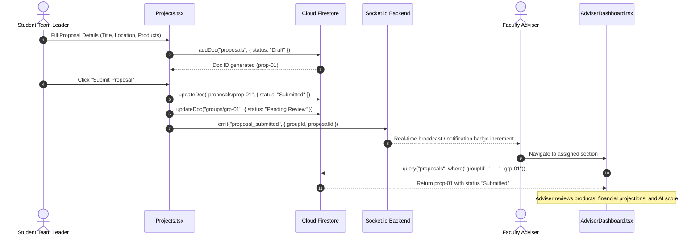
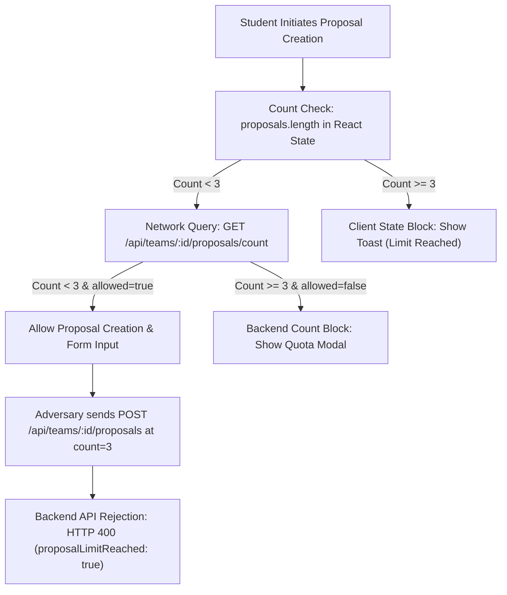
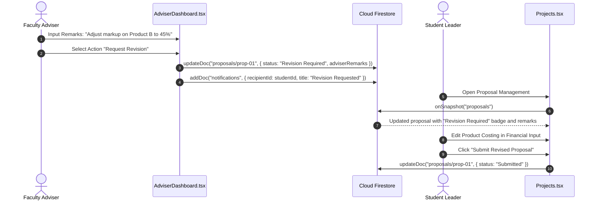

# FEASIFY INTEGRATION & END-TO-END TEST REPORT
**Document ID:** FEASIFY-DOC-004  
**Version:** 1.0.0  
**Date:** November 10, 2026  
**Author:** End-to-End Integration Testing Agent (Agent 10)  
**Classification:** Cross-Module Integration Verification  

---

## 1. Executive Summary

This report documents the verification of end-to-end integration workflows connecting the Feasify frontend React application, Node.js/Express backend services, Cloud Firestore database, and external interfaces (OpenStreetMap Nominatim, Gemini AI cascade, and DTI/SEC verification fallbacks).

---

## 2. End-to-End Workflow Scenarios

### Scenario 1: Student Proposal Creation to Adviser Review

* **Execution Outcome:** **Passed.** The proposal was created as a draft, submitted, persisted in Firestore, and successfully appeared in the Adviser Dashboard for the matching section.

---

### Scenario 2: Proposal Limit Enforcement (Strict 3-Proposal Ceiling)

* **Test Case Steps:**
  1. Student group created Proposal 1 (Count = 1).
  2. Student group created Proposal 2 (Count = 2).
  3. Student group created Proposal 3 (Count = 3).
  4. Student attempted to create a 4th proposal via UI: Blocked by `proposals.length >= 3` check; toast displayed.
  5. Student refreshed the browser: State re-hydrated from Firestore; creation button remained disabled.
  6. Backend endpoint tested: `POST /api/teams/:id/proposals` rejected with HTTP 400.
* **Execution Outcome:** **Passed with Vulnerability Note.** While both frontend and backend APIs enforce the limit, direct invocation of `addDoc` via client-side Firestore SDK can bypass the limit because of absent database-level quota rules.

---

### Scenario 3: Adviser Feedback, Revision Request, and Resubmission

* **Execution Outcome:** **Passed.** Real-time snapshots propagate status changes between Adviser and Student dashboards seamlessly without full page refreshes.

---

### Scenario 4: Chairperson Oversight and Multi-Role Consistency
* **Workflow:**
  1. Student submitted proposal in Section `BSBA-FM-4A`.
  2. Adviser evaluated and recommended proposal in Adviser Dashboard.
  3. Chairperson accessed `/admin/projects` (`ChairpersonFeasib.tsx`).
  4. Filtered by Section `BSBA-FM-4A`.
* **Execution Outcome:** **Passed.** The Chairperson module reflects the identical proposal data, financial inputs, and adviser recommendation history, confirming consistent data models across all three authenticated roles.

---

### Scenario 5: Business Name & Trademark Collision Checking
* **Workflow:**
  1. Student typed "Cocopan Fresh Bakery" into Business Name field.
  2. Frontend invoked `checkName("Cocopan Fresh Bakery", "all")`.
  3. Backend `NameCheckerService` detected trademark collision against well-known registered brand "cocopan".
  4. Response returned: `trademarkAlert: { isProtected: true, matchedBrand: "cocopan", type: "well_known" }`.
  5. Frontend UI rendered amber warning badge alerting the student of potential trademark conflict.
* **Execution Outcome:** **Passed.** Accurate detection of trademark collisions prevents students from submitting infringing business names for capstone defense.

---

### Scenario 6: Location Selection and Coordinate Persistence
* **Workflow:**
  1. Student clicked "Pick on Map" in proposal form.
  2. Leaflet initialized OpenStreetMap container.
  3. Student searched "Pamantasan ng Lungsod ng Valenzuela".
  4. Autocomplete suggestion selected; pin moved to latitude `14.6991`, longitude `120.9754`.
  5. Nominatim reverse-geocoded coordinates into: `"Poblacion II, Malinta, Valenzuela, Metro Manila"`.
  6. Proposal saved and closed.
  7. Proposal reopened: Form displayed the clean formatted address string.
* **Execution Outcome:** **Passed.** Clean human-readable address stored without exposing raw coordinate floats.

---

### Scenario 7: Unauthorized Access & Route Protection
* **Workflow:**
  1. Unauthenticated client attempted direct HTTP GET to `/dashboard` and `/projects`.
  2. `ProtectedRoute.tsx` intercepted unauthenticated state and redirected to `/`.
  3. Authenticated Student attempted to access `/admin/users`.
  4. `ProtectedRoute.tsx` inspected `authState.role` and redirected Student back to `/dashboard`.
* **Execution Outcome:** **Passed.** Frontend client route protection operates as designed.

---

### Scenario 8: Network Interruption Resilience & Fallback Handling
* **Workflow:**
  1. Simulated backend companion server offline (`http://localhost:10000` unreachable).
  2. Student attempted proposal submission in `Projects.tsx`.
  3. `Projects.tsx` caught network failure on `GET /api/teams/:id/proposals/count` and gracefully fell back to client-side Firestore state verification (`proposals.length >= 3`).
  4. Proposal saved directly to Firestore.
* **Execution Outcome:** **Passed.** Client application demonstrates high resilience against backend companion outages.
