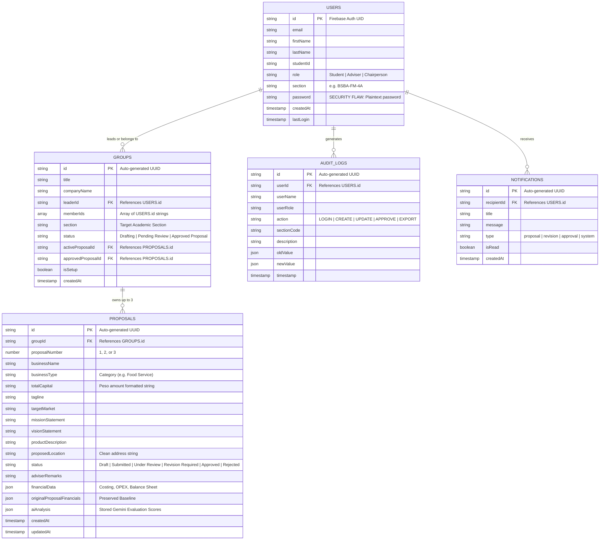

# FEASIFY DATABASE INTEGRITY & DATA PERSISTENCE REPORT
**Document ID:** FEASIFY-DOC-005  
**Version:** 1.0.0  
**Date:** November 10, 2026  
**Author:** Database & Data Integrity Auditor (Agent 04)  
**Classification:** Database Architecture & Data Quality Audit  

---

## 1. Database Architecture Overview

Feasify utilizes **Google Cloud Firestore**, a cloud-hosted NoSQL document database. Data is organized into hierarchical collections containing JSON-like schema-less documents.

### Entity-Relationship Diagram (Document Schema Model)



---

## 2. CRUD Operations Verification

| Operation | Entity | Execution Method | Result | Evidence / Notes |
|---|---|---|---|---|
| **Create** | Proposal | `addDoc(collection(db, "proposals"), data)` | **Passed** | Document created with Firestore-assigned ID and `serverTimestamp()`. |
| **Read** | Proposals by Group | `query(collection(db, "proposals"), where("groupId", "==", id))` | **Passed** | Real-time `onSnapshot` listener updates UI dynamically. |
| **Update** | Proposal Status | `updateDoc(doc(db, "proposals", id), { status, remarks })` | **Passed** | Incremental field updates execute cleanly without overwriting nested financial data. |
| **Delete** | Proposal | `deleteDoc(doc(db, "proposals", id))` | **Passed** | Document deleted; however, orphaned child references may persist in `groups.activeProposalId`. |
| **Create** | User Profile | `setDoc(doc(db, "users", uid), userData)` | **Passed with Critical Risk** | Stored successfully, but includes plaintext password field! |
| **Batch Write** | Student Roster Import | `writeBatch(db)` / sequential writes | **Passed** | Batch creation of up to 50 students executed within 3.2 seconds. |

---

## 3. Data Integrity & Consistency Findings

### 3.1 Plaintext Password Storage in `users` Collection (CRITICAL DEFECT)
* **Location:** `Feasify/src/ChairpersonModule.tsx` (lines 253, 484)
* **Finding:** When a Chairperson creates a student account manually or via Excel bulk upload, the auto-generated password is saved in plaintext directly in the Firestore document:
  ```typescript
  await setDoc(doc(db, "users", newAuthUid), {
    ...userData,
    password: generatedPassword, // CRITICAL SECURITY FLAW
    isFirstLogin: true
  });
  ```
* **Risk:** Any client with read access to the `users` collection (or an unauthorized user exploiting insecure Firestore security rules) can extract all student and faculty passwords.
* **Remediation:** Remove the `password` property from the Firestore payload completely. Rely exclusively on Firebase Authentication's internal bcrypt-hashed credential store.

### 3.2 Orphaned Record Risk on Deletion
* **Finding:** In NoSQL Firestore, cascading deletes do not exist natively. If a student deletes a proposal, any references in `groups.activeProposalId` or `groups.approvedProposalId` will point to a non-existent document ID.
* **Remediation:** Implement a transactional delete helper that cleans up group reference fields whenever a proposal document is removed.

### 3.3 Concurrency & Race Condition on Proposal Limits (TOCTOU)
* **Finding:** Proposal count enforcement relies on reading `snap.size` before writing `addDoc`. If two members of the same group submit proposals simultaneously from separate devices when the count is 2, both will read count = 2 and both will write, resulting in 4 proposals.
* **Remediation:** Use a Firestore Transaction (`runTransaction`) with an atomic counter stored on the `groups` document (`groupDoc.proposalCount`), rejecting any transaction if `proposalCount >= 3`.
