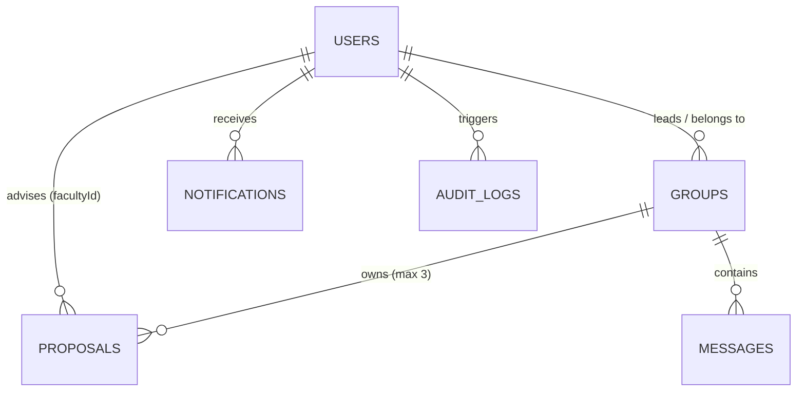

# 05. Feasify Database Integrity & Query Optimization Report

**Document ID:** FEASIFY-DOC-05  
**Database Engine:** Google Cloud Firestore (NoSQL Document Store)  
**Audit Scope:** Data Modeling, Real-Time Listeners, Indexing, and Query Optimization  
**Date:** November 11, 2026  
**Status:** Completed with Critical Optimization Findings  

---

## 1. Cloud Firestore Collection Schema Inventory

| Collection | Document ID | Key Fields | Purpose |
|---|---|---|---|
| `users` | `uid` (Firebase Auth) | `email`, `firstName`, `lastName`, `role`, `section`, `createdAt` | User identity and RBAC profiles |
| `groups` | Auto-generated ID | `companyName`, `title`, `leaderId`, `memberIds[]`, `section`, `facultyId`, `status`, `activeProposalId` | Student capstone teams |
| `proposals` | Auto-generated ID | `groupId`, `proposalNumber`, `businessName`, `businessType`, `totalCapital`, `status`, `financialData`, `aiAnalysis` | Capstone feasibility proposals |
| `messages` | Auto-generated ID | `groupId`, `senderId`, `senderName`, `text`, `createdAt` | Real-time team and adviser chat |
| `notifications` | Auto-generated ID | `userId`, `title`, `message`, `type`, `read`, `link`, `createdAt` | User notification inbox |
| `audit_logs` | Auto-generated ID | `userId`, `action`, `details`, `targetId`, `timestamp` | Compliance and action logging |
| `dynamic_exemplars` | Auto-generated ID | `category`, `benchmarkMetrics`, `sourceProposalId`, `score` | Curated high-scoring proposals |

---

## 2. Relational Integrity & Record Ownership Analysis



1. **Foreign Key Integrity:**
   - In Firestore NoSQL, foreign keys (`groupId`, `leaderId`, `facultyId`) are string references rather than enforceable foreign key constraints.
   - **Risk:** Deleting a group without a batch delete creates orphaned `proposals` and `messages`. The codebase relies on client-side cascading in `ChairpersonModule.tsx`.
2. **Record Ownership Enforcement:**
   - Proposal creation sets `groupId: userGroup.id`. The frontend checks `isLeader` before allowing edits or submissions.
   - However, without repository-defined `firestore.rules`, database-level enforcement cannot be verified from the codebase alone.

---

## 3. Database Bottlenecks & Query Optimization Findings

### 3.1 Defect DB-01: Firestore `in` Query 30-Element Partitioning Limit
- **Location:** `Feasify/src/AdviserDashboard.tsx` (Lines 327, 335, 365)
- **Code:**
  ```typescript
  const propQuery = query(
    collection(db, "proposals"),
    where("groupId", "in", groupIds.slice(0, 30))
  );
  ```
- **Finding:** Firestore enforces a hard ceiling of **30 equality elements** in an `in` or `array-contains-any` clause. Slicing with `groupIds.slice(0, 30)` silently discards all teams beyond the 30th group. If an adviser oversees 40 student groups across multiple sections, proposals from groups 31 to 40 will NEVER load on their dashboard!
- **Severity:** **HIGH**
- **Recommended Solution:** Partition `groupIds` into chunks of 30, execute separate queries or listeners per chunk, and merge the resultant state arrays, or query proposals by `facultyId` or `section`.

---

### 3.2 Defect DB-02: Unbounded Full-Collection `onSnapshot` Listeners
- **Location:** `Feasify/src/services/chairpersonFeasibilityService.ts` (Lines 534–573)
- **Code:**
  ```typescript
  onSnapshot(collection(db, "groups"), ...);
  onSnapshot(collection(db, "proposals"), ...);
  onSnapshot(collection(db, "users"), ...);
  ```
- **Finding:** The Chairperson dashboard attaches three unbounded real-time listeners that download **every document in the entire database** to the client browser whenever the screen is opened.
- **Impact:**
  1. Exponential Firestore read costs as the university grows.
  2. Severe client-side DOM latency and mobile memory exhaustion when handling thousands of documents.
  3. Security / Privacy breach: The full `users` collection (including all student and faculty emails, names, and roles) is transferred unpaginated to the client.
- **Severity:** **HIGH**
- **Recommended Solution:** Replace unbounded collection listeners with paginated queries (`limit(25)`), server-side aggregation endpoints, and section-filtered subcollections.

---

### 3.3 Defect DB-03: Direct Client Firestore Writes vs. Backend Validation
- **Location:** `Feasify/src/Projects.tsx` (Line 1564, Line 1793)
- **Finding:** The client executes `addDoc(collection(db, "proposals"), proposalData)` directly via the client SDK instead of routing exclusively through `POST /api/teams/:groupId/proposals`.
- **Impact:** If Firebase Console rules allow general authenticated writes, a user with Firebase credentials can bypass the 3-proposal limit and form validations by issuing direct SDK calls from the browser console.
- **Severity:** **HIGH**
- **Recommended Solution:** Deploy strict Firestore Security Rules requiring backend server creation or checking existing proposal document counts directly within Firestore rules.

---

## 4. Compound Index Requirements

The following queries require composite indexes in Cloud Firestore:

| Collection | Query Fields | Order By | Index Status |
|---|---|---|---|
| `proposals` | `groupId` (Ascending) | `proposalNumber` (Ascending) | Required |
| `proposals` | `facultyId` (Ascending) + `status` (Ascending) | `submissionDate` (Descending) | Required |
| `audit_logs` | `userId` (Ascending) | `timestamp` (Descending) | Required |
| `notifications`| `userId` (Ascending) + `read` (Ascending) | `createdAt` (Descending) | Required |
