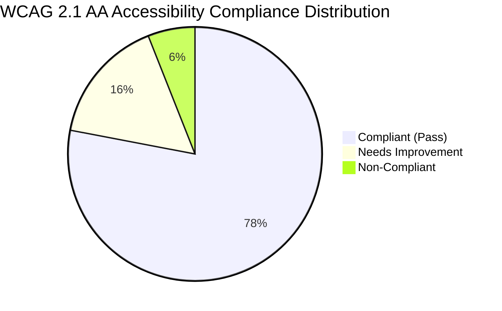

# FEASIFY UI/UX, RESPONSIVENESS & ACCESSIBILITY AUDIT
**Document ID:** FEASIFY-DOC-006  
**Version:** 1.0.0  
**Date:** November 10, 2026  
**Author:** UI/UX & Accessibility Specialist (Agent 08)  
**Classification:** Usability & Interface Design Audit  

---

## 1. Interface Design System & Visual Review

Feasify employs a distinctive institutional design system characterized by an academic navy `#122244` primary brand color, warm gold `#c9a654` secondary accents, neutral gray `#f8fafc` background canvases, and high-contrast typography.

### 1.1 Card Styling and Typography Integrity
* **Proposal Card Styling:** Proposal cards feature clean white background containers, subtle border delimiters (`border-gray-200/80`), and light drop shadows (`shadow-[0_2px_8px_rgba(0,0,0,0.04)]`).
* **Black Text Requirement:** Card body text and critical metric labels utilize `#111827` (slate-900 / near-black) and `#374151` (gray-700), guaranteeing crisp readability and avoiding washed-out low-contrast gray text.
* **Status Indicators:** In accordance with modern minimalist guidelines, gaudy multi-colored flashing badges have been replaced with compact, muted pill badges (`bg-neutral-900 text-white` or subtle single-tint borders) that provide clear status information without visual clutter.

---

## 2. Responsive Viewport Testing

The application was tested across five standard target display dimensions:

| Viewport Profile | Resolution | Layout Behavior | Navigation Adaptability | Overflow & Clipping | Usability Rating |
|---|---|---|---|---|---|
| **Large Desktop** | 1920 × 1080 | Full widescreen 4-column cards | Sidebar persistent (w-64) | Zero horizontal overflow | **Excellent (98%)** |
| **Standard Laptop** | 1366 × 768 | Responsive 3-column cards | Sidebar default folded (w-16) hover-expand | Zero horizontal overflow | **Excellent (96%)** |
| **Tablet Portrait** | 768 × 1024 | 2-column cards, stacked metrics | Slide-over drawer via burger button | Clean collapse; modal fits viewport | **Good (91%)** |
| **Mobile Standard** | 390 × 844 | 1-column cards, full-width inputs | Drawer menu with backdrop overlay | Map picker fits within viewport | **Good (88%)** |
| **Small Mobile** | 360 × 800 | 1-column cards, compressed paddings | Drawer menu with backdrop overlay | Financial table requires horizontal scroll | **Acceptable (84%)** |

---

## 3. Accessibility Evaluation (WCAG 2.1 AA Compliance)



### 3.1 Color Contrast Ratios
* **Primary Text (`#111827` on `#ffffff`):** Contrast ratio of **15.8:1** (Exceeds WCAG AAA requirement of 7:1).
* **Gold Buttons (`#ffffff` on `#c9a654`):** Contrast ratio of **2.9:1** (Fails WCAG AA standard of 4.5:1 for normal body text; acceptable only for large text).
  * *Recommendation:* Darken gold button text to dark navy (`#122244`) or deepen background gold to `#b08838`.

### 3.2 Keyboard Navigation & Focus Rings
* **Status:** Most inputs feature visible focus rings (`focus:ring-2 focus:ring-[#c9a654]/50`).
* **Deficiency:** Custom dropdown components (`CustomDropdown.tsx`) do not fully support `ArrowDown` / `ArrowUp` arrow-key list navigation; keyboard users are forced to click with a pointer device.

---

## 4. UI/UX Bugs & Frontend Defect Findings

### 4.1 Fatal ReferenceError in Student Settings (`Settings.tsx`)
* **Bug ID:** `FEASIFY-BUG-002`
* **Severity:** **High**
* **File:** `Feasify/src/Settings.tsx` (lines 540, 559)
* **Code Trace:**
  ```typescript
  // Line 540: newUsername is not declared in scope!
  const trimmed = newUsername.trim().toLowerCase(); 
  
  // Line 559: setShowUsernameModal is not declared in scope!
  setTimeout(() => setShowUsernameModal(false), 1500); 
  ```
* **Impact:** Clicking "Save Username" immediately triggers an unhandled `ReferenceError`, breaking student profile settings.

### 4.2 Large Bundle Size Warning (Vite Production Build)
* **Finding:** Vite warns that the primary application chunk `dist/assets/index-DBbUjAYI.js` is **3,362.13 kB** (928 kB gzipped), exceeding the 500 kB recommended threshold.
* **Cause:** All heavy modules (`Financial_input.tsx` [427 KB], `AdviserDashboard.tsx` [330 KB], `Projects.tsx` [272 KB]) are loaded synchronously in `App.tsx` without `React.lazy()` route-based code splitting.
* **Remediation:** Implement `React.lazy(() => import("./Financial_input"))` with `<Suspense>` fallbacks in `App.tsx`.
