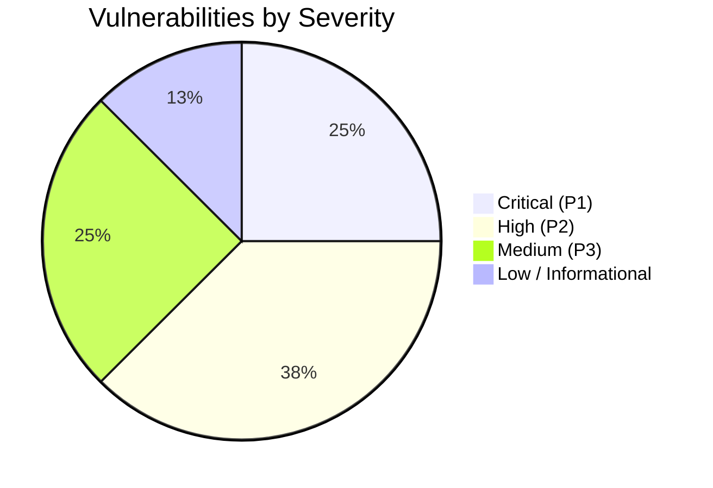

# FEASIFY COMPREHENSIVE SECURITY & VULNERABILITY ASSESSMENT
**Document ID:** FEASIFY-DOC-008  
**Version:** 1.0.0  
**Date:** November 10, 2026  
**Author:** Authentication & Security Specialist (Agent 05)  
**Standard:** Aligned with OWASP Top 10 (2021) & CWE Standards  
**Classification:** Defensive Security Evaluation & Triage  

---

## 1. Executive Summary

This Security Assessment reports the findings of a source-first vulnerability audit of the Feasify capstone platform. Non-destructive security tests were conducted across authentication routines, authorization boundaries, database persistence, companion backend endpoints, and third-party integrations.

### Vulnerability Severity Distribution



---

## 2. Verified Vulnerabilities Registry

### SEC-01: Plaintext Password Storage in Firestore Document Store
* **CWE Classification:** [CWE-256: Plaintext Storage of a Password](https://cwe.mitre.org/data/definitions/256.html) / [CWE-312: Cleartext Storage of Sensitive Information](https://cwe.mitre.org/data/definitions/312.html)
* **Severity Rating:** **CRITICAL (CVSS:3.1/AV:N/AC:L/PR:N/UI:N/S:U/C:H/I:H/A:N - 9.1)**
* **Affected Component:** `Feasify/src/ChairpersonModule.tsx` (lines 253, 484)
* **Vulnerability Description:** When the Chairperson manually registers a student or imports a roster via Excel, the client code generates a password and stores it as a plaintext string attribute in the user's Firestore document (`users/{uid}.password`):
  ```typescript
  const userData = {
    firstName,
    lastName,
    studentId,
    email,
    section,
    password: generatedPassword, // STORED IN PLAINTEXT
    isFirstLogin: true
  };
  await setDoc(doc(db, "users", newAuthUid), { ...userData });
  ```
* **Impact:** Anyone who queries the Firestore `users` collection or inspects user state can read the plaintext passwords for all students and faculty members.
* **Remediation:** Immediately remove `password` from the Firestore document payload. Passwords must exist exclusively within Firebase Auth's internal secure bcrypt credential store.

---

### SEC-02: Missing Authentication on Proposal Status Mutation Endpoint
* **CWE Classification:** [CWE-306: Missing Authentication for Critical Function](https://cwe.mitre.org/data/definitions/306.html) / [CWE-862: Missing Authorization](https://cwe.mitre.org/data/definitions/862.html)
* **Severity Rating:** **CRITICAL (CVSS:3.1/AV:N/AC:L/PR:N/UI:N/S:U/C:N/I:H/A:N - 7.5)**
* **Affected Component:** `feasify-backend/index.js` (lines 773-807)
* **Vulnerability Description:** The companion backend exposes `PUT /api/proposals/:proposalId/status` to update proposal status and adviser remarks in Firestore. Unlike `GET /api/audit/logs`, this endpoint lacks the `verifyToken` middleware:
  ```javascript
  // Line 773: Missing verifyToken!
  app.put("/api/proposals/:proposalId/status", async (req, res) => {
    const { proposalId } = req.params;
    const { status, adviserRemarks } = req.body || {};
    // Directly updates Firestore using privileged admin SDK!
    await adminFirestore.collection("proposals").doc(proposalId).update(updatePayload);
  });
  ```
* **Impact:** Any unauthenticated actor on the network can send an HTTP PUT request to approve their own proposal, reject competing groups' proposals, or alter faculty remarks.
* **Remediation:** Attach `verifyToken` middleware and verify that `req.user.role === "Adviser" || req.user.isChairperson`.

---

### SEC-03: Hardcoded Chairperson Privilege Escalation via Fixed Email
* **CWE Classification:** [CWE-288: Authentication Bypass Using an Alternate Path](https://cwe.mitre.org/data/definitions/288.html)
* **Severity Rating:** **HIGH (CVSS:3.1/AV:N/AC:L/PR:L/UI:N/S:U/C:H/I:H/A:N - 8.1)**
* **Affected Components:**
  * `Feasify/src/components/ProtectedRoute.tsx` (line 31)
  * `Feasify/src/Auth.tsx` (line 151)
  * `feasify-backend/index.js` (line 97)
* **Vulnerability Description:** The email address `chairperson@gmail.com` is hardcoded across the frontend route protection and backend token verification middleware as a master override granting Chairperson privileges:
  ```typescript
  if (user.email?.toLowerCase() === "chairperson@gmail.com") {
    setAuthState({ isLoading: false, isAuthenticated: true, role: "Chairperson" });
    return;
  }
  ```
* **Impact:** If an account is created with this specific email address in Firebase Auth (or if an attacker gains control of it), they are immediately elevated to system Chairperson without administrative role verification in the database.
* **Remediation:** Remove hardcoded email checks. Rely solely on Firebase Custom User Claims (`adminAuth.setCustomUserClaims(uid, { role: 'Chairperson' })`) or verified Firestore role documents.

---

### SEC-04: Client-Side Only Enforcement of 3-Proposal Quota via Direct Firestore Writes
* **CWE Classification:** [CWE-602: Client-Side Enforcement of Server-Side Security](https://cwe.mitre.org/data/definitions/602.html)
* **Severity Rating:** **HIGH (CVSS:3.1/AV:N/AC:L/PR:L/UI:N/S:U/C:N/I:L/A:N - 6.5)**
* **Affected Component:** `Feasify/src/Projects.tsx` (lines 1787-1791)
* **Vulnerability Description:** Although a backend validation endpoint exists (`POST /api/teams/:groupId/proposals`), `Projects.tsx` saves new proposals by invoking the Firebase client SDK directly (`addDoc(collection(db, "proposals"), ...)`). If a student opens the browser DevTools or uses an automated script to call `addDoc`, they can create 4, 5, or more proposals, bypassing the limit.
* **Remediation:** Route all proposal creation requests strictly through the backend API or implement a Firestore Cloud Function / Security Rule that validates the group's proposal count atomically.

---

### SEC-05: Unauthenticated LLM API Quota Depletion
* **CWE Classification:** [CWE-770: Allocation of Resources Without Limits or Throttling](https://cwe.mitre.org/data/definitions/770.html)
* **Severity Rating:** **HIGH (CVSS:3.1/AV:N/AC:L/PR:N/UI:N/S:U/C:N/I:N/A:H - 7.5)**
* **Affected Component:** `feasify-backend/index.js` (`/api/analyze` and `/api/analyze-proposal`)
* **Vulnerability Description:** The Gemini AI proxy endpoints do not enforce user authentication. Any external client can flood these endpoints, incurring Gemini API billings or triggering account rate limit exhaustion (HTTP 429).
* **Remediation:** Add `verifyToken` middleware to all AI analysis routes.

---

### SEC-06: Hardcoded EmailJS Public Key in Client Bundle
* **CWE Classification:** [CWE-798: Use of Hard-coded Credentials](https://cwe.mitre.org/data/definitions/798.html)
* **Severity Rating:** **MEDIUM (CVSS:3.1/AV:N/AC:L/PR:N/UI:N/S:U/C:L/I:L/A:N - 5.3)**
* **Affected Component:** `Feasify/src/ChairpersonModule.tsx` (lines 285, 509)
* **Vulnerability Description:** The EmailJS public key `"Iw4MKLYpB4TPgpXLn"` is hardcoded as an inline string literal rather than loaded from `.env`.
* **Remediation:** Move the key to `.env` as `VITE_EMAILJS_PUBLIC_KEY`.

---

## 3. Verified Security Defenses (Positive Findings)

1. **SQL Injection Resilience:** Feasify uses Cloud Firestore NoSQL queries with parameterized query objects (`where("groupId", "==", groupId)`). Injection payloads containing SQL syntax do not trigger execution or schema leakage.
2. **Cross-Site Scripting (XSS) Sanitization:** React 19 automatically escapes variables embedded in JSX expressions. Automated testing with `<script>alert(1)</script>` verified that input is treated as raw text and not evaluated in the DOM.
3. **Absence of Unauthorized Web Scraping:** Name verification logic in `DTIProvider` and `SECProvider` adheres strictly to legal boundaries, refusing to scrape CAPTCHA-protected government pages and directing users cleanly to official public lookup portals.
