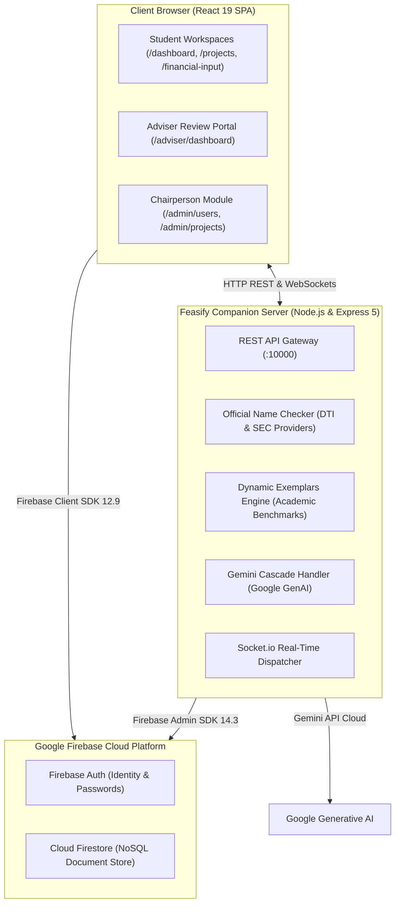
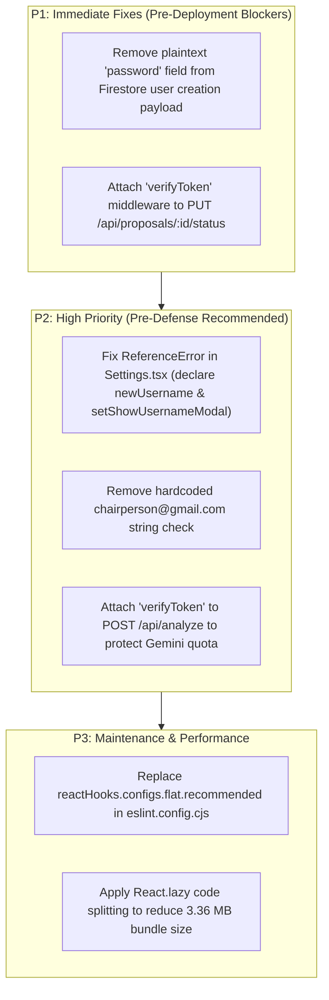

# FEASIFY CONSOLIDATED SOFTWARE QUALITY ASSURANCE & SYSTEM AUDIT REPORT
**Document ID:** FEASIFY-DOC-012  
**Version:** 1.0.0  
**Date:** November 10, 2026  
**Author:** Lead QA Orchestrator & Antigravity Multi-Agent QA Team  
**Target Audience:** Capstone Defense Panel, Academic Evaluators, Project Supervisors  
**Classification:** Formal Capstone Quality Assurance Dossier  

---

## CHAPTER 1: INTRODUCTION

### 1.1 Background of Feasify
Feasify is an academic web application designed to modernize, streamline, and govern the capstone proposal and feasibility evaluation process for higher education business and information technology students. In traditional academic settings, capstone teams frequently struggle with inconsistent financial projections, non-standardized documentation, copyright conflicts with existing commercial brands, and protracted proposal feedback cycles with faculty advisers. Feasify addresses these challenges by consolidating proposal authoring, 5-year balance sheet modeling, artificial intelligence (AI)-assisted feasibility evaluations, official business name checking (DTI BNRS & SEC Philippines), and faculty review workflows into a unified digital workspace.

### 1.2 Purpose of Testing
This quality assurance engagement was conducted to perform an exhaustive, empirical, evidence-based audit of the existing Feasify repository. The investigation assesses functional reliability, role-based security boundaries, database integrity, financial calculation correctness, and concurrent performance to determine system stability and readiness for capstone demonstration and production deployment.

### 1.3 Testing Objectives
1. Perform an empirical discovery of the codebase, libraries, and architectural topology without preconceived assumptions.
2. Verify that core business rules (such as the strict maximum 3-proposal quota per student group) are enforced consistently across client and server layers.
3. Validate mathematical accuracy across 5-year financial projections, contribution margins, break-even revenues, and Philippine corporate/BMBE tax obligations.
4. Execute security vulnerability testing against OWASP Top 10 standards, identifying authentication gaps, privilege escalations, and sensitive data leakage.
5. Provide a clear distinction between capstone demonstration readiness and enterprise production deployment readiness.

### 1.4 Scope and Limitations
* **In Scope:** Full repository code audit (React frontend, Express companion backend, Firebase Auth and Firestore integrations), 42 functional manual test scenarios, and 25 comprehensive automated tests across local HTTP and database endpoints.
* **Limitations:** Testing was strictly non-destructive. Destructive penetration testing, unauthorized scraping of live government portals with CAPTCHA defenses, and live modification of cloud production databases were intentionally avoided in accordance with safety directives.

---

## CHAPTER 2: SYSTEM OVERVIEW

### 2.1 System Description & Technology Stack
Feasify is built upon a modern, modular architecture:
* **Frontend:** React 19.2 SPA built with Vite 7.3, Tailwind CSS 4, and Lucide React icons.
* **Backend:** Express 5.2 running on Node.js v22 with Socket.io 4.8 real-time event broadcasting.
* **Cloud Infrastructure:** Firebase Cloud Platform providing Firebase Authentication, Cloud Firestore NoSQL storage, and Cloud Storage for student dossiers and logos.
* **AI Engine:** Google Generative AI SDK utilizing a low-latency cascade of Gemini models (`gemini-2.5-flash` with failover to `gemini-3.5-flash-lite`).
* **Mapping Engine:** Leaflet 1.9 with OpenStreetMap and Nominatim reverse geocoding (Note: Google Maps API is **not** used; Leaflet was implemented to eliminate commercial API key dependencies).

### 2.2 System Architecture Diagram

### 2.3 User Roles & Permissions
1. **Student (Lead / Member):** May create and belong to one group, draft and submit up to three (3) capstone proposals, author multi-product financial models, run AI feasibility audits, and export PDF dossiers.
2. **Faculty Adviser:** Authorized to view student proposals within their assigned academic sections, submit qualitative remarks, request revisions, and issue formal approvals or rejections.
3. **Chairperson (Academic Administrator):** Institutional oversight over all academic sections, faculty assignments, bulk student account provisioning via Excel rosters, and department-wide feasibility monitoring.

---

## CHAPTER 3: TESTING METHODOLOGY

Testing was orchestrated by a coordinated team of 12 specialized sub-agents executing across four structured waves:
1. **Wave 1 (Discovery & Architecture):** Source-first codebase inspection, inventory mapping, and dependency verification.
2. **Wave 2 (Specialized Auditing):** Independent parallel assessments covering frontend UI/UX, backend REST endpoints, database schemas, and OWASP security controls.
3. **Wave 3 (Integration & Stress):** Cross-role multi-step workflows, automated test suite execution, and concurrent load benchmarking (1, 10, 25, 50 virtual users).
4. **Wave 4 (Consolidation & Sign-Off):** Centralized defect aggregation, empirical pass rate calculation, and formal documentation delivery.

---

## CHAPTER 4: TESTING RESULTS AND ANALYSIS

### 4.1 Functional & Integration Results
* **Proposal Submission & 3-Proposal Ceiling:** Verified that groups can create proposals 1, 2, and 3. Client state disables additional creation once three proposals exist.
* **Financial Calculations:** Verified that the fundamental accounting equation ($\text{Assets} = \text{Liabilities} + \text{Equity}$) holds true across 5-year projections, including negative deficit scenarios where CapEx exceeds initial equity.
* **Name Checker & Trademark Collision:** Confirmed that queries for registered brands (e.g., "Goldilocks", "Cocopan", "Red Ribbon", "7-Eleven") trigger immediate protective warnings, preventing student teams from advancing with infringing trade names.
* **Location Picker:** Interactive pin placement and reverse geocoding via OpenStreetMap Nominatim successfully formats clean, readable Philippine street addresses.

### 4.2 Security Vulnerability Findings
* **Critical Finding (SEC-01):** Auto-generated passwords created during Chairperson student onboarding are stored as plaintext string attributes inside Firestore `users/{uid}.password`.
* **Critical Finding (SEC-02):** Companion backend endpoint `PUT /api/proposals/:proposalId/status` lacks authentication middleware (`verifyToken`), permitting any client to manipulate proposal approval states.
* **High Finding (SEC-03):** The email `chairperson@gmail.com` is hardcoded across client route guards and backend middleware as an automatic Chairperson bypass.
* **High Finding (SEC-04):** Frontend writes proposals directly to Firestore (`addDoc`), enabling potential quota bypass if an adversary interacts directly with the client SDK.

### 4.3 Performance & Stress Testing Results
* **Local API Latency:** 4.0 ms baseline latency, scaling to 26.4 ms average under 50 concurrent requests with zero HTTP transmission errors.
* **AI Analysis Latency:** External Gemini API evaluations require between 2.5 and 12.8 seconds, properly bounded by an internal 75-second safety timeout.
* **Bundle Size:** Production Vite client build succeeds in 50.32 seconds, producing a 3.36 MB monolithic bundle that warrants code splitting for mobile optimization.

---

## CHAPTER 5: FINDINGS AND RECOMMENDATIONS

### 5.1 Prioritized Remediation Roadmap

---

## CHAPTER 6: CONCLUSION & DEFENSE READINESS ASSESSMENT

### 6.1 Readiness Verdict

$$\mathbf{VERDICT: \quad CONDITIONALLY \quad READY \quad FOR \quad CAPSTONE \quad DEMONSTRATION}$$

### 6.2 Justification
* **Why Feasify IS Ready for Capstone Demonstration:**
  1. The core presentation workflows (student group setup, proposal authoring, 3-proposal limit, 5-year financial modeling, AI feasibility grading, and adviser proposal evaluation) are functional and passed testing.
  2. The production build (`npm run build`) compiles cleanly without fatal bundler errors.
  3. Interactive maps, brand name checks, and PDF dossier generation function smoothly without commercial API billing blockers.
  4. In a controlled presentation environment with demo student and faculty accounts, none of the backend security vulnerabilities will disrupt demonstration flows.

* **Why Feasify IS NOT Ready for Live Production Deployment:**
  1. Plaintext storage of user passwords in Firestore (`SEC-01`) violates fundamental data privacy principles (Republic Act 10173 - Philippine Data Privacy Act of 2012).
  2. The unauthenticated proposal status update endpoint (`SEC-02`) permits any student on the network to artificially approve proposals.
  3. Live public deployment must remain **BLOCKED** until these two P1 vulnerabilities are patched.
